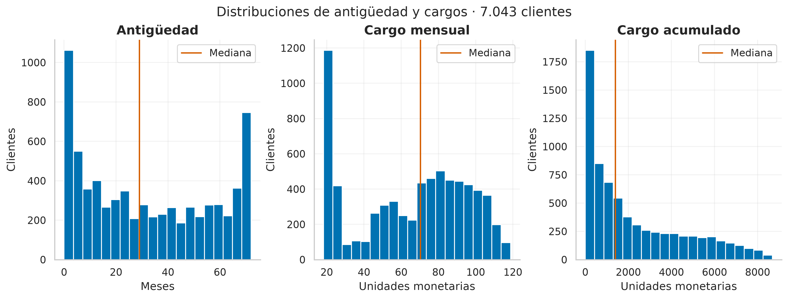
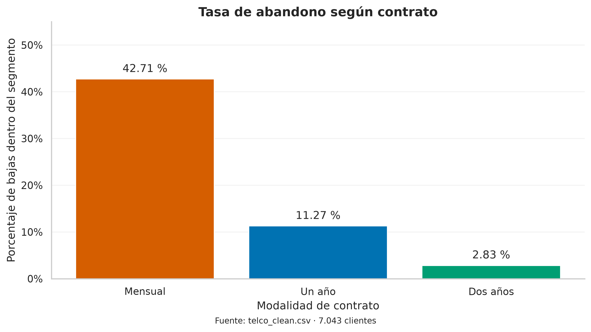

# Abandono de clientes en telecomunicaciones

**Informe ejecutivo · Parte 1: problema, metodología, limpieza y análisis exploratorio**

| Datos de presentación | |
|---|---|
| Institución | Universidad Tecnológica Nacional · Facultad Regional Avellaneda |
| Materia | Introducción al Análisis de Datos |
| División | 343 · Segundo cuatrimestre de 2026 |
| Integrantes | Matías, Julián y Emmanuel |
| Fecha de elaboración | 18 de noviembre de 2026 |
| Dataset | Telco Customer Churn · Kaggle |
| Responsable de esta parte | Matías · Tarea 30 |

Esta parte constituye el texto fuente para el informe conjunto. La tarea 31 incorporará visualización, preprocesamiento, modelos, métricas y conclusiones estratégicas, y ensamblará el PDF con numeración. Los nombres se presentan tal como figuran en el repositorio.

## 1. Resumen ejecutivo

El análisis de 7.043 clientes de telecomunicaciones identifica 1.869 bajas registradas, equivalentes al **26,54 % de la cartera**. El abandono presenta diferencias importantes entre segmentos: alcanza el **42,71 % en contratos mensuales**, frente al 11,27 % en contratos de un año y al 2,83 % en contratos de dos años. Además, los clientes con hasta 12 meses de antigüedad tienen una tasa de baja del **47,44 %**, frente al 17,13 % de quienes superan ese plazo.

Estas diferencias orientan la investigación comercial hacia la experiencia inicial y las condiciones de contratación. También se observan tasas elevadas en fibra óptica y cheque electrónico. Los segmentos se superponen: un mismo cliente puede ser nuevo, tener contrato mensual, fibra y pagar con cheque electrónico. Por lo tanto, las tasas no deben sumarse ni interpretarse como efectos independientes.

La preparación de los datos conservó todos los clientes. Se convirtieron los cargos acumulados a formato numérico y se imputaron 11 valores faltantes con cero, bajo la suposición de que los clientes con cero meses de antigüedad todavía no acumularon cargos. El dataset final contiene 22 variables y no presenta faltantes; la regla de 1,5 veces el rango intercuartílico no detectó atípicos en las tres variables principales.

La evidencia es descriptiva: no demuestra que cambiar el contrato, el precio o el medio de pago reduzca el abandono. Para decidir una campaña se necesitan costos, capacidad de contacto y una medición de su efecto. El modelado y su evaluación se desarrollan en la segunda parte del informe.

## 2. Problema de negocio y objetivos

La baja de clientes reduce los pagos futuros que puede percibir una empresa de telecomunicaciones. Comprender cómo se distribuye el abandono permite identificar grupos donde investigar problemas de servicio, incorporación o propuesta comercial.

**Pregunta de negocio:** ¿cómo se relacionan la modalidad de contrato, la antigüedad y el cargo mensual con el abandono registrado en Telco Customer Churn?

El objetivo general es analizar los factores asociados al abandono y preparar una base reproducible para clasificar la etiqueta disponible. Los objetivos específicos son comparar tasas entre segmentos, evaluar las tres hipótesis definidas en la tarea 4 y aportar evidencia para orientar futuras acciones de retención.

La unidad de análisis es un cliente. La variable objetivo, `Churn`, es cualitativa nominal binaria: `Yes` indica una baja registrada y `No`, permanencia registrada. En esta parte se conserva ese texto. La tasa de abandono de un segmento se calcula como bajas del segmento divididas por sus clientes, multiplicadas por 100. Esto distingue una alta proporción de bajas de un simple volumen grande de clientes.

## 3. Datos y metodología

El archivo original tiene 7.043 filas y 21 columnas. Es un dataset estructurado porque cada fila representa un cliente y las columnas tienen encabezados, significados y dominios comunes. Contiene características sociodemográficas, servicios, contratación, antigüedad, cargos y abandono. `customerID` identifica al cliente y no aporta una medida de su comportamiento.

El trabajo siguió esta secuencia:

1. Inspeccionar dimensiones, tipos, faltantes y duplicados del archivo original.
2. Corregir `TotalCharges`, adecuar tipos, retirar el identificador y agregar variables calculadas.
3. Revisar atípicos, completitud, validez, unicidad y consistencia; exportar `telco_clean.csv`.
4. Calcular estadísticos, correlaciones y tasas por segmento sobre el dataset limpio.
5. Contrastar descriptivamente las hipótesis y redactar sus implicancias y límites.

La estadística descriptiva utiliza los 7.043 registros. El desvío estándar es muestral; la curtosis se expresa como exceso de Fisher. Pearson resume asociación lineal y Spearman, asociación entre rangos. Las diferencias entre tasas se expresan en puntos porcentuales. No se realizaron pruebas de significación para las hipótesis de este informe.

El EDA caracteriza la muestra completa y no constituye una evaluación predictiva independiente. En las tareas posteriores se separan train y test antes de ajustar transformaciones; los ajustes del preprocesamiento y del modelo se realizan con entrenamiento. Si se usan estos hallazgos para elegir modelos o variables, esa elección debe validarse dentro de train. El detalle del flujo y sus controles corresponde a la segunda parte.

## 4. Limpieza y calidad

| Hallazgo o decisión | Tratamiento y fundamento |
|---|---|
| `TotalCharges` leído como texto | Se retiraron espacios y se convirtió a numérico, haciendo fallar la conversión ante texto inesperado. |
| 11 cargos acumulados vacíos (0,16 %) | Se imputaron con `0.0` exclusivamente cuando `tenure = 0`. Se conserva al cliente; el valor depende de la suposición de que aún no acumuló cargos. |
| Tipos categóricos | Se definieron 17 variables categóricas; `SeniorCitizen` se representó como `No/Yes`. El formato CSV requiere restaurar el esquema al leer. |
| Identificador | Se eliminó `customerID` luego de verificar que los 7.043 identificadores originales eran distintos. |
| Variables calculadas | `ingreso_estimado = MonthlyCharges × tenure`; `diferencia_facturacion = TotalCharges − ingreso_estimado`. Son aproximaciones aritméticas, no ingresos ni ajustes contables verificados. |
| Valores atípicos | Cero casos fuera de Q1 − 1,5 × IQR y Q3 + 1,5 × IQR en `tenure`, `MonthlyCharges` y `TotalCharges`. Se conservaron los valores. |
| Perfiles repetidos | Hay 22 filas repetidas posteriores a la primera coincidencia al retirar el identificador. Corresponden a clientes distintos con igual perfil; se conservaron. |
| Exportación | Dataset final de 7.043 filas y 22 columnas: 17 categóricas y 5 numéricas, sin faltantes. |

La tarea 9 documenta 16 controles de completitud, validez y consistencia, incluidos dominios permitidos y coherencia entre servicios. La ausencia de atípicos por IQR y de contradicciones en estos controles no garantiza que todo dato sea correcto: describe el alcance de las verificaciones aplicadas.

## 5. Análisis exploratorio

### 5.1. Antigüedad y cargos

Las cifras siguientes se recalcularon sobre `telco_clean.csv`. Los cargos se expresan en unidades monetarias del dataset, sin convertir moneda.

| Variable | Media | Mediana | Moda | Desvío muestral | Mínimo | Máximo |
|---|---:|---:|---:|---:|---:|---:|
| Antigüedad (meses) | 32,37 | 29,00 | 1,00 | 24,56 | 0,00 | 72,00 |
| Cargo mensual | 64,76 | 70,35 | 20,05 | 30,09 | 18,25 | 118,75 |
| Cargo acumulado | 2.279,73 | 1.394,55 | 0,00 | 2.266,79 | 0,00 | 8.684,80 |

| Variable | Q1 | Q3 | Rango | IQR | Asimetría | Exceso de curtosis |
|---|---:|---:|---:|---:|---:|---:|
| Antigüedad | 9,00 | 55,00 | 72,00 | 46,00 | 0,24 | −1,39 |
| Cargo mensual | 35,50 | 89,85 | 100,50 | 54,35 | −0,22 | −1,26 |
| Cargo acumulado | 398,55 | 3.786,60 | 8.684,80 | 3.388,05 | 0,96 | −0,23 |

**Tabla 1.** Resumen numérico; 7.043 observaciones válidas en cada variable. La moda de cargo acumulado pasa a cero por los 11 valores imputados; no debe interpretarse como un cargo típico observado.

La antigüedad reúne clientes nuevos y otros con varios años: el 50 % central se ubica entre 9 y 55 meses. El cargo mensual también es heterogéneo; la mitad central abarca 54,35 unidades monetarias. Conviene comparar segmentos antes de usar un promedio único para decisiones comerciales.

En el cargo acumulado, la media supera ampliamente a la mediana y la asimetría es positiva. Los valores altos elevan el promedio; la mediana ayuda a describir el centro de esa distribución. El exceso de curtosis es negativo en las tres variables, sin que esto equivalga a una prueba de normalidad.



**Figura 1.** Histogramas del dataset limpio; la línea naranja indica la mediana. Las escalas son propias de cada variable. La distribución de cargos acumulados se extiende hacia importes altos, mientras que la antigüedad muestra presencia tanto de clientes recientes como de larga permanencia. Esto respalda estudiar la cartera por etapas de relación comercial.

### 5.2. Correlaciones

| Par de variables | Pearson | Spearman |
|---|---:|---:|
| Antigüedad y cargo acumulado | 0,826 | 0,890 |
| Cargo mensual y cargo acumulado | 0,651 | 0,638 |
| Antigüedad y cargo mensual | 0,248 | 0,276 |

**Tabla 2.** Correlaciones sobre 7.043 pares completos en todos los casos.

La asociación más alta corresponde a antigüedad y cargo acumulado: quienes llevan más meses suelen acumular más cargos. Spearman es mayor que Pearson en ese par, lo que indica una asociación más fuerte en el orden de los valores que en su relación lineal. La relación entre antigüedad y cargo mensual es bastante menor: conocer los meses de servicio aporta información limitada sobre cuánto paga un cliente cada mes. Estas correlaciones no miden directamente el abandono ni demuestran causalidad.

### 5.3. Contratación, servicio y pago

| Segmento | Clientes | Bajas | Tasa de abandono |
|---|---:|---:|---:|
| Contrato mensual | 3.875 | 1.655 | 42,71 % |
| Contrato de un año | 1.473 | 166 | 11,27 % |
| Contrato de dos años | 1.695 | 48 | 2,83 % |
| Internet por fibra óptica | 3.096 | 1.297 | 41,89 % |
| Internet DSL | 2.421 | 459 | 18,96 % |
| Sin internet | 1.526 | 113 | 7,40 % |
| Cheque electrónico | 2.365 | 1.071 | 45,29 % |
| Cheque postal | 1.612 | 308 | 19,11 % |
| Transferencia bancaria automática | 1.544 | 258 | 16,71 % |
| Tarjeta de crédito automática | 1.522 | 232 | 15,24 % |

**Tabla 3.** Tasas calculadas dentro de cada segmento. Cada familia de segmentación cubre la cartera; las familias comparten clientes.

Los contratos mensuales concentran 1.655 de las 1.869 bajas (**88,55 % de las bajas**). Esa concentración combina su tamaño con una tasa elevada. Fibra óptica y cheque electrónico también presentan proporciones altas, pero no puede atribuirse ese abandono al servicio o al método de pago sin considerar otras características compartidas.



**Figura 2.** La altura representa una tasa, no un conteo. El contrato mensual supera al de un año por 31,44 puntos porcentuales y al de dos años por 39,88. La diferencia orienta la investigación de propuestas de permanencia; no permite estimar el efecto de cambiar un contrato.

### 5.4. Evaluación descriptiva de las hipótesis

| Hipótesis de la tarea 4 | Evidencia en el dataset limpio | Resultado descriptivo |
|---|---|---|
| H1: contrato mensual con mayor abandono que contratos de uno y dos años | 42,71 % frente a 11,27 % y 2,83 % | Respaldada en la muestra. |
| H2: hasta 12 meses con mayor abandono que más de 12 meses | 1.037/2.186 = 47,44 % frente a 832/4.857 = 17,13 %; diferencia de 30,31 puntos | Respaldada en la muestra. |
| H3: cargo mensual superior a la mediana con mayor abandono | Mediana: 70,35. Por encima: 1.237/3.515 = 35,19 %; hasta la mediana: 632/3.528 = 17,91 %; diferencia de 17,28 puntos | Respaldada en la muestra. |

**Tabla 4.** Se conservaron las definiciones de grupo de la tarea 4. El corte de cargo mensual se obtiene de la distribución de esa variable, sin buscar un umbral que maximice la diferencia de abandono. “Respaldada” describe el sentido observado de las tasas; no significa confirmación causal ni significación estadística.

El primer año aparece como una etapa relevante para investigar la experiencia de incorporación. La asociación del cargo alto con mayor abandono requiere distinguir precio, servicios y contrato antes de plantear incentivos. Una lectura útil consiste en contrastar clientes comparables y medir cualquier intervención posterior.

## 6. Límites y continuidad del informe

El dataset no aporta una secuencia fechada que permita validar un horizonte futuro de abandono ni verificar para todos los predictores su disponibilidad previa a la baja. Los resultados describen la etiqueta registrada. El traslado a una operación real requiere datos temporales y evaluación con clientes futuros.

La imputación de cargos acumulados es una suposición documentada. Las variables calculadas derivan de cargos y antigüedad y pueden introducir redundancia; no representan información comercial independiente. Tampoco se dispone de costos de retención o de pérdida por cliente para estimar rentabilidad.

La segunda parte incorporará las visualizaciones restantes, el preprocesamiento, la justificación de modelos, sus métricas y las conclusiones estratégicas. Las recomendaciones deberán distinguir una asociación descriptiva, la capacidad de clasificación y el efecto comprobado de una acción comercial.

## 7. Fuentes internas y reproducción

La fuente primaria es el [CSV original](../data/raw/WA_Fn-UseC_-Telco-Customer-Churn.csv); las tablas y figuras de esta parte usan exclusivamente el [dataset limpio](../data/processed/telco_clean.csv). El [plan de tareas](../PLAN_TAREAS.md) establece alcance, contratos de datos y revisión cruzada.

La fundamentación proviene de la [tarea 4](../notebooks/trabajo/4_problema_hipotesis.ipynb). Las decisiones de limpieza y calidad están documentadas en las tareas [6](../notebooks/trabajo/6_totalcharges.ipynb), [7](../notebooks/trabajo/7_tipos_columnas.ipynb), [8](../notebooks/trabajo/8_outliers.ipynb) y [9](../notebooks/trabajo/9_dataset_limpio.ipynb). El EDA se desarrolla en las tareas [10](../notebooks/trabajo/10_estadistica_descriptiva.ipynb), [11](../notebooks/trabajo/11_correlaciones.ipynb), [12](../notebooks/trabajo/12_analisis_categorico.ipynb), [13](../notebooks/trabajo/13_filtrado_avanzado.ipynb) y [14](../notebooks/trabajo/14_segmentacion_groupby.ipynb).

El resumen de la tarea 15 y algunas interpretaciones de los notebooks 10 y 11 conservan cifras provisorias. Este informe las actualiza: para `TotalCharges`, la media limpia es 2.279,73 y la mediana 1.394,55, sobre 7.043 clientes, en lugar de 2.283,30 y 1.397,48 sobre 7.032 valores disponibles. Las cifras provisorias no deben trasladarse al PDF final.

Para regenerar la evidencia, instalar `requirements.txt` y ejecutar desde el repositorio:

```console
python docs/30_reproducir_eda.py
```

El script exporta tablas sin redondear a `reports/tables/30_*.csv` y las dos figuras a `reports/figures/30_*.png`, usando el estilo de la tarea 16. Las tablas del texto se redondean solo para presentación. La revisión cruzada de esta tarea corresponde a Emmanuel y queda pendiente antes del merge.
