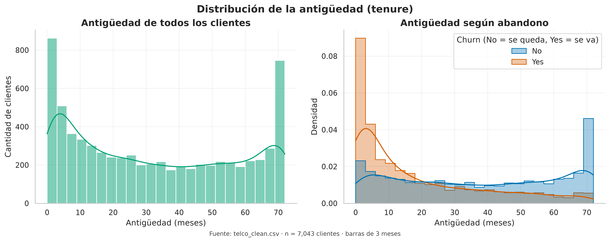
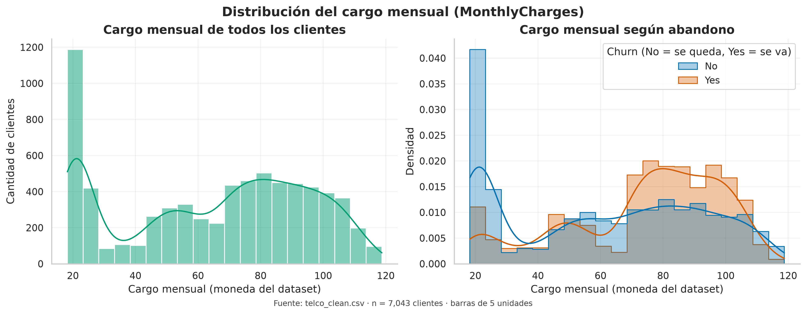
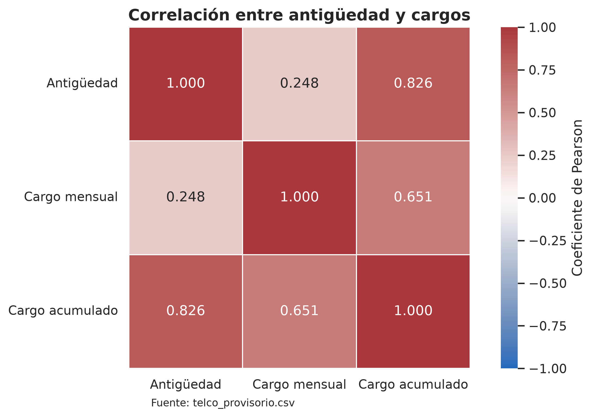
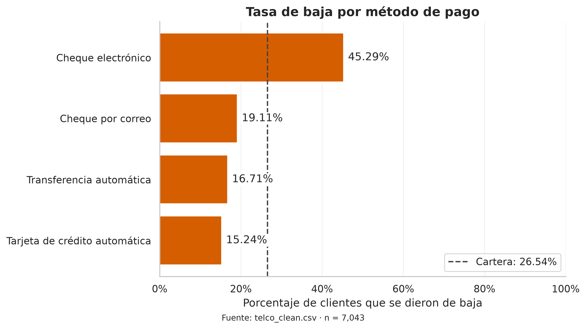
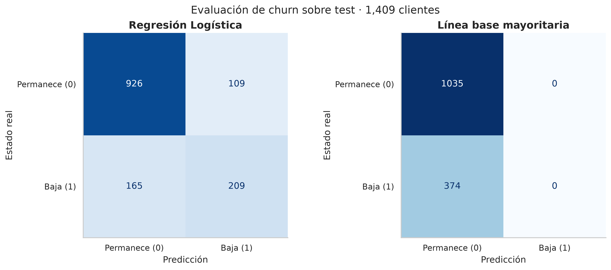
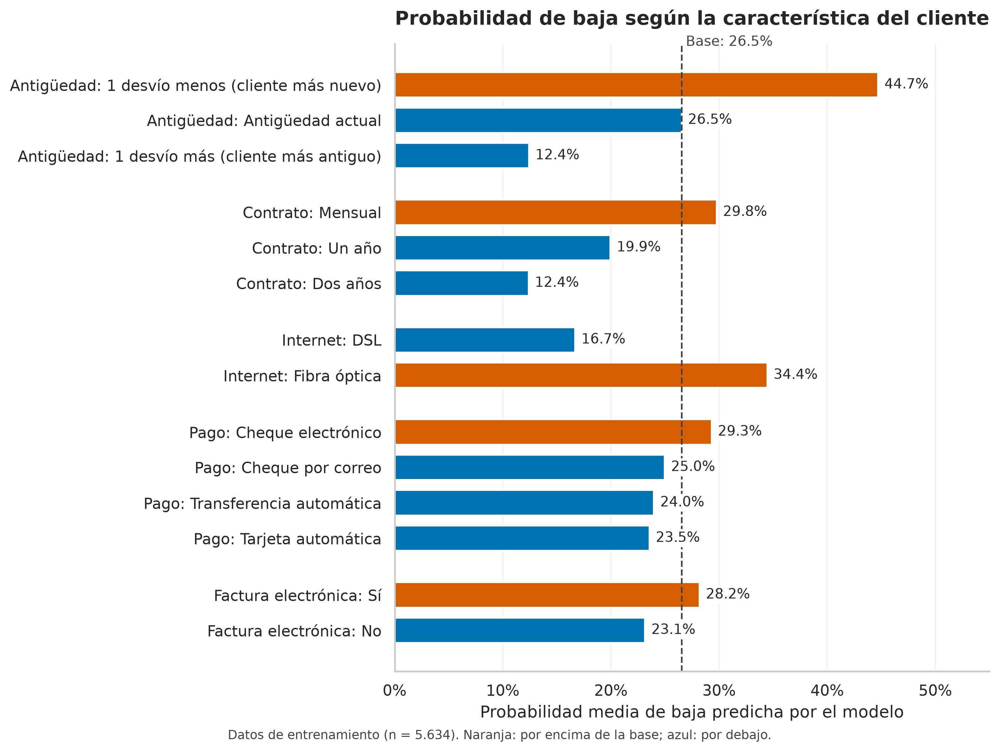

# Parte II · Visualización, modelado y conclusiones

## 7. Visualización de la cartera

Las figuras de esta sección usan el dataset limpio (7.043 clientes) y el estilo común definido en la tarea 16. Cada una se acompaña de una lectura orientada al negocio. Las tasas se calculan dentro de cada grupo, como en la Parte I.

### 7.1. Antigüedad y cargo mensual



**Figura 3.** Histograma con curva de densidad (KDE) de la antigüedad. A la izquierda, todos los clientes; a la derecha, comparación entre quienes se quedaron (azul) y quienes se fueron (naranja), en escala de densidad para poder comparar formas.

La distribución tiene dos concentraciones: alrededor del 21 % de los clientes lleva seis meses o menos y 362 clientes (5,1 %) llegan al máximo de 72 meses. La media (32,4 meses) cae entre ambos extremos, donde hay menos clientes, por lo que no describe a un cliente típico. Quienes se fueron tienen una antigüedad mediana de 10 meses, frente a 38 meses de quienes se quedaron. La tasa de baja es de 52,9 % entre los clientes con seis meses o menos y de 6,6 % entre quienes llevan 61 meses o más.



**Figura 4.** Histograma con KDE del cargo mensual, con la misma estructura que la Figura 3.

También el cargo mensual se reparte en dos grupos: uno grande que paga menos de 30 (23,5 % de los clientes) y otro que paga entre 70 y 100 (38,2 %). La mediana de cargo mensual de quienes se fueron es de 79,65, frente a 64,43 de quienes se quedaron. La tasa de baja es de 9,8 % entre quienes pagan menos de 30 y de 38,0 % entre quienes pagan entre 70 y 100. Los dos gráficos coinciden en una idea: el abandono se concentra en clientes nuevos y de cargo mensual alto. Es una asociación observada, no una prueba de causa.

### 7.2. Relaciones entre variables numéricas



**Figura 5.** Matriz de correlación de Pearson entre antigüedad, cargo mensual y cargo acumulado. La escala es divergente y está centrada en cero.

La relación más fuerte es entre antigüedad y cargo acumulado (0,826), algo esperable porque el acumulado crece con los meses de servicio. El cargo mensual se asocia con el acumulado (0,651) y poco con la antigüedad (0,248). Esta redundancia entre variables de facturación reaparece al interpretar el modelo (sección 10).

### 7.3. Tasa de baja por método de pago



**Figura 6.** Porcentaje de clientes que se dieron de baja en cada método de pago. La línea punteada marca la tasa de toda la cartera (26,54 %).

El cheque electrónico tiene la tasa más alta (45,29 %), frente a 19,11 % del cheque por correo, 16,71 % de la transferencia automática y 15,24 % de la tarjeta automática. La tasa por contrato, ya presentada en la Figura 2, muestra una diferencia aún mayor (42,71 %, 11,27 % y 2,83 %). Ambos grupos se superponen en los mismos clientes, por lo que la diferencia entre métodos de pago no debe leerse de forma aislada: parte de ella se explica por otras características, como se verifica en la sección 10.

## 8. Preparación de los datos para el modelado

Antes de entrenar un modelo, los datos se transforman a un formato numérico y se separan en dos conjuntos: uno para que el modelo aprenda (entrenamiento) y otro para medir cuánto acierta con clientes que no vio (prueba). Esta separación se hace **antes** de ajustar cualquier transformación, para evitar la fuga de datos (*data leakage*): que información de la prueba influya en el entrenamiento y las métricas resulten optimistas.

| Paso | Decisión | Fundamento |
|---|---|---|
| Variable objetivo | `Churn` codificada como 0 (permanece) y 1 (baja) | Los modelos requieren un objetivo numérico. |
| Partición | 80 % entrenamiento (5.634 clientes) y 20 % prueba (1.409), estratificada, con semilla 42 | La estratificación mantiene la proporción de bajas en ambos conjuntos (26,5 %) y la semilla permite repetir la división. |
| Variables nominales | Codificación *One-Hot*: una columna 0/1 por categoría, con 15 variables que dan 40 columnas | Evita asignar un orden artificial a categorías sin jerarquía. `PaymentMethod` se codificó completa, sin agrupar métodos. |
| Contrato | Codificación ordinal: mensual = 0, un año = 1, dos años = 2 | El contrato tiene un orden natural de compromiso y esa gradación aporta información al modelo. |
| Variables numéricas | Estandarización (`StandardScaler`) de las cinco variables numéricas | Lleva cada variable a media cero y desvío uno; la regresión logística es sensible a la escala. |
| Ajuste de las transformaciones | Solo con los datos de entrenamiento; la prueba únicamente se transforma | Previene la fuga de datos. |

**Tabla 5.** Resumen del preprocesamiento. Resultado: 46 variables predictoras por cliente.

La tarea 24 verificó el orden de las operaciones: ningún ajuste (`fit`) recibió datos de prueba, no hay clientes compartidos entre ambos conjuntos y `Churn` no se filtra a los predictores. Esa revisión tiene un límite que debe declararse: el análisis exploratorio de la Parte I se calculó sobre la muestra completa, por lo que el conjunto de prueba no es una muestra totalmente externa. Las decisiones de modelado no se tomaron mirando los resultados de prueba.

## 9. Modelos y evaluación

Se entrenaron dos modelos con objetivos distintos, como pide la consigna: uno que estima un número (regresión) y otro que predice una categoría (clasificación).

### 9.1. Regresión lineal simple: estimar el cargo acumulado

**Objetivo:** estimar `TotalCharges` a partir de la antigüedad (`tenure`). Se usó la antigüedad en meses, sin estandarizar, para que el coeficiente conserve su significado en unidades monetarias por mes. El modelo se ajustó con el 80 % de los clientes y se evaluó con el 20 % restante.

| Resultado | Valor |
|---|---:|
| Ecuación | cargo estimado = −196,86 + 76,73 × meses |
| R² en prueba | 0,670 |
| Error absoluto medio (MAE) en prueba | 892,38 |
| MAE de la referencia que predice siempre el promedio | 1.919,51 |

**Tabla 6.** Resultados de la regresión lineal simple sobre 1.409 clientes de prueba. Los importes están en las unidades monetarias del dataset.

**Lectura.** Por cada mes adicional de antigüedad, la recta estima 76,73 unidades más de cargo acumulado. El R² de 0,670 indica que la antigüedad explica cerca de dos tercios de la variación del cargo acumulado en la prueba; el tercio restante depende de lo que paga cada cliente por mes y de sus servicios. El MAE de 892,38 equivale a unos 40 % del cargo acumulado promedio de prueba (2.250,33) y es menos de la mitad del error de la referencia que predice el promedio (1.919,51): el modelo aporta información, aunque con un error considerable. Además, el intercepto negativo no tiene sentido como cargo real y 202 de las 1.409 estimaciones de prueba (14,3 %) resultan negativas, sobre todo en clientes nuevos: es una limitación de ajustar una recta a una relación que parte de cero. Dado que el cargo acumulado es aproximadamente el cargo mensual multiplicado por los meses, la antigüedad sola es un predictor razonable, pero un modelo con más variables podría reducir el error. Un R² alto no implica que la antigüedad *cause* el cargo acumulado ni que se acierte en el 67 % de los casos.

### 9.2. Regresión logística: predecir la baja

**Objetivo:** predecir si un cliente se va (`Churn = 1`) o se queda (`Churn = 0`).

**Por qué este modelo.** El objetivo es binario; el modelo devuelve una probabilidad de baja, y no solo una etiqueta; sus coeficientes se pueden interpretar; y es sensible a la escala, razón por la cual se estandarizaron las variables numéricas. La consigna pide un único modelo de clasificación elemental. Se entrenó con 5.634 clientes y 46 variables, con una iteración máxima de 1.000 y la semilla 42; el ajuste convergió en 40 iteraciones. La probabilidad se convierte en predicción con el umbral habitual de 0,5.

**Referencia de comparación.** Como la mayoría de los clientes permanece (73,5 % en la prueba), un “modelo” que siempre responda “se queda” acertaría ese porcentaje sin detectar ninguna baja. La exactitud del modelo solo tiene valor si supera esa línea base.

| | Línea base (siempre “se queda”) | Regresión logística |
|---|---:|---:|
| Aciertos sobre 1.409 clientes | 1.035 | 1.135 |
| Exactitud (*accuracy*) | 73,46 % | 80,55 % |
| Bajas detectadas (de 374 reales) | 0 | 209 (55,9 %) |

**Tabla 7.** Comparación sobre el conjunto de prueba. El modelo mejora la línea base en 7,10 puntos porcentuales (100 aciertos más).

| | Predice “se queda” | Predice “se va” |
|---|---:|---:|
| **Realmente se queda** | 926 (verdaderos negativos) | 109 (falsos positivos) |
| **Realmente se va** | 165 (falsos negativos) | 209 (verdaderos positivos) |

**Tabla 8.** Matriz de confusión del modelo sobre el conjunto de prueba.



**Figura 7.** Matrices de confusión de la regresión logística y de la línea base, con la misma escala de color.

**Lectura.** El modelo acierta 8 de cada 10 clientes, pero la exactitud sola es engañosa: **detecta 56 de cada 100 bajas reales** (209 de 374) y deja pasar las otras 44 (165 falsos negativos). De las 318 alertas que emite, el 65,7 % corresponde a bajas reales y 109 son clientes que se habrían quedado. Cada tipo de error tiene un costo distinto: un falso negativo es un cliente que se va sin que se lo contacte, y un falso positivo es un cliente que recibe una acción de retención sin necesitarla. El dataset no informa el costo de contactar a un cliente ni el valor de perderlo, por lo que no se puede decidir cuál error conviene evitar más. Si perder un cliente cuesta más que contactarlo, convendría ajustar el umbral, y esa decisión debe tomarse con validación dentro del entrenamiento y no con la prueba.

## 10. Qué factores empujan hacia la baja

Los coeficientes del modelo permiten ver qué características se asocian con una mayor o menor probabilidad de baja. Leerlos directamente induce a error por dos motivos que se verificaron en la tarea 28: siete columnas del modelo representan la misma información (“el cliente no tiene internet”) y el modelo reparte entre ellas el efecto, y las variables de facturación (`TotalCharges`, `ingreso_estimado` y `diferencia_facturacion`) son combinaciones exactas entre sí, de modo que sus coeficientes individuales no son confiables. Por eso se tradujo el efecto de cada característica a **probabilidad media de baja**: se fijó la característica en todos los clientes de entrenamiento, dejando lo demás igual, y se calculó lo que predice el modelo.



**Figura 8.** Probabilidad media de baja predicha por el modelo al fijar cada característica en todos los clientes de entrenamiento. La línea punteada marca la probabilidad media actual (26,5 %).

| Variable | Efecto sobre la probabilidad de baja | Solidez |
|---|---|---|
| Antigüedad | 44,7 % con un desvío (unos 25 meses) menos y 12,4 % con uno más | Alta |
| Tipo de contrato | Mensual 29,8 %, un año 19,9 %, dos años 12,4 % | Alta |
| Internet de fibra óptica | 34,4 % con fibra frente a 16,7 % con DSL | Alta |
| Cheque electrónico | 29,3 % frente a 23,5 % con tarjeta automática | Moderada |
| Factura electrónica | 28,2 % con ella y 23,1 % sin ella | Moderada |

**Tabla 9.** Variables con efecto más claro. La solidez se evaluó reentrenando el modelo sin las variables de facturación calculadas: antigüedad, contrato y fibra óptica casi no cambian.

Dos observaciones de lectura. Primero, el efecto del cheque electrónico en el modelo (unos 6 puntos porcentuales) es mucho menor que la diferencia observada en los datos crudos (45,29 % frente a 15,24 % y 16,71 % en los pagos automáticos): una vez que el modelo ya considera el contrato, la antigüedad y el servicio, queda poco de la diferencia atribuible solo al método de pago. Segundo, el cargo mensual aparece con signo negativo en el modelo aunque quienes se van pagan más; ocurre porque el cargo alto se refleja a través del tipo de servicio (la fibra óptica, que es más cara) y el modelo no le suma efecto propio. Por eso el cargo mensual no debe interpretarse de manera aislada.

## 11. Conclusiones estratégicas

La evidencia de las dos partes del informe señala dónde conviene concentrar la atención. Cada recomendación se apoya en un resultado y distingue lo observado de lo que habría que comprobar.

1. **Concentrar la retención en el primer año.** Los clientes con hasta 12 meses se dieron de baja en un 47,44 %, frente a 17,13 % del resto, y la antigüedad es el factor de mayor peso en el modelo. *Acción a evaluar:* programas de bienvenida, seguimiento temprano y ofertas en los primeros meses.
2. **Incentivar el paso del contrato mensual a uno de mayor plazo.** El contrato mensual reúne el 88,55 % de las bajas (42,71 % de tasa, frente a 11,27 % y 2,83 %). *Acción a evaluar:* ofrecer beneficios por migrar a un contrato anual. Hay que comprobar si quienes eligen un contrato largo son simplemente clientes más comprometidos desde el inicio.
3. **Revisar la propuesta de valor de la fibra óptica.** Tiene una tasa de baja de 41,89 %, frente a 18,96 % en DSL, y el modelo mantiene una diferencia de 18 puntos al considerar otras características. *Acción a evaluar:* relevar calidad de servicio, precio y satisfacción de estos clientes.
4. **Promover el pago automático.** El cheque electrónico concentra la mayor tasa (45,29 %). La diferencia se reduce mucho al controlar otras variables, por lo que se sugiere como acción complementaria y de bajo costo, no como causa principal.
5. **Usar el modelo como herramienta de priorización, no como decisión automática.** Con una exactitud de 80,55 % y una detección del 55,9 % de las bajas, sirve para ordenar la cartera por riesgo y dirigir acciones, pero omite casi la mitad de las bajas y genera 109 alertas innecesarias. Su uso requiere definir el costo de cada tipo de error.
6. **Medir antes de generalizar.** Ninguna de estas acciones está demostrada. Se recomienda un piloto con un grupo de control: aplicar la acción a una parte de los clientes de riesgo y comparar su tasa de baja con la del resto.

## 12. Limitaciones y próximos pasos

- **Asociación, no causalidad.** Los resultados describen qué características acompañan a las bajas. No demuestran que cambiar el contrato, el precio o el medio de pago reduzca el abandono.
- **Sin dimensión temporal.** El dataset no tiene fechas, por lo que no se puede validar un horizonte de predicción ni comprobar que todas las variables estén disponibles antes de la baja.
- **Clases desbalanceadas y un único modelo.** Hay 26,5 % de bajas, y el umbral de 0,5 favorece a la clase mayoritaria. La consigna pide un modelo elemental; no se compararon otros algoritmos ni se ajustó el umbral.
- **Prueba no totalmente externa.** El análisis exploratorio se hizo sobre la muestra completa, aunque el preprocesamiento y el modelo se ajustaron solo con entrenamiento.
- **Variables redundantes.** Las variables de facturación calculadas son combinaciones de otras y limitan la lectura individual de los coeficientes. El cargo acumulado de 11 clientes se imputó con cero, bajo una suposición documentada.
- **Sin costos.** No se dispone del costo de retención ni del valor de un cliente, por lo que no se estimó rentabilidad.
- **Sin pruebas de significación.** Las diferencias entre tasas se describen, no se contrastaron estadísticamente.

**Próximos pasos posibles:** incorporar datos fechados, evaluar el umbral con validación cruzada dentro del entrenamiento, comparar con otros modelos y estimar los costos reales de cada tipo de error.

## 13. Fuentes internas y reproducción

El dataset original es `data/raw/WA_Fn-UseC_-Telco-Customer-Churn.csv` y todo el análisis de esta parte usa `data/processed/telco_clean.csv` y los conjuntos derivados de la partición. El código está en `notebooks/trabajo/`, con un notebook por tarea:

- Visualización: tareas 16 a 20 (`16_estilo_graficos`, `17_histogramas_kde`, `18_heatmap_correlacion`, `19_barras_churn`).
- Preprocesamiento: tareas 21 a 24 (`21_particion_datos`, `22_codificacion`, `23_escalado`, `24_verificacion_antileakage`).
- Modelado: tareas 25 a 28 (`25_regresion_lineal`, `26_regresion_logistica`, `27_evaluacion_clasificacion`, `28_interpretacion_coeficientes`).

Las figuras están en `reports/figures/`. Para regenerar este documento en PDF, instalar `markdown` (`pip install markdown`) y ejecutar desde la raíz del repositorio:

```console
python docs/31_ensamblar_informe.py
```

El script combina el resumen ejecutivo, la Parte I (`docs/30_informe_ejecutivo_parte1.md`) y esta Parte II, agrega la carátula y genera `docs/INFORME_EJECUTIVO.pdf` con Google Chrome o Microsoft Edge instalado.
